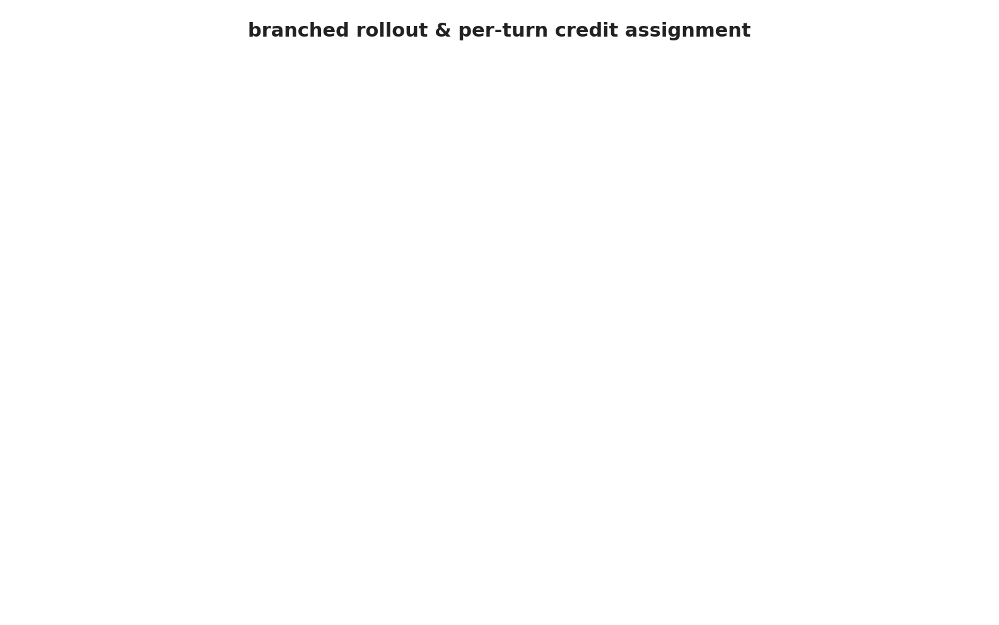

# Learning to probe before acting: a multi-turn RL approach

A small research codebase for teaching a 4B-parameter LLM to write Python
control policies, on a single 24 GB GPU.

The model doesn't just emit code in one shot. It interacts with a task over
two chat turns: a first turn it can use to probe the environment or sketch a
draft, and a final turn that must commit a `def policy(state)` body. Only the
final policy is executed and scored. Training has to figure out, from that
single scalar reward, whether the *probe* was useful or whether the final
policy happened to work for unrelated reasons. That credit-assignment problem
is what this project exists to study.

The accompanying paper is in `docs/paper.tex` ("Learning to Probe Before
Acting"). The dated experiment log is in `docs/findings.tex`.

## What it's training

- **Base model:** `Qwen/Qwen3-4B-Instruct-2507` (override with
  `LORA4VR_BASE_MODEL`). Weights are frozen; only a LoRA adapter is trained.
- **Task family:** a seeded batch cooling crystallizer. A saturated
  solution holding seed crystals is cooled to a target temperature, and the
  policy sets the cooling rate every 20 s. Cooling creates supersaturation,
  the seeds grow and consume it, and if the supersaturation ever crosses a
  hidden metastable limit a shower of new nuclei ruins the batch. The
  fastest safe recipe rides just below that limit, and the limit shows up
  nowhere in the readings until it is crossed. The first turn, the **probe
  run**, is where the model can find it, by crossing it on a throwaway
  batch; the second turn, the **final run**, is the one that is scored. The
  environment source ships inside each prompt, so the model has to read the
  physics rather than recognize a name.
- **Loop:** a sequence of outer iterations. Each one trains a fresh LoRA on
  top of the merged previous adapters, then runs an eval pass on held-out
  scenarios.

## The idea, in plain language

<p align="center">
  
  <br>
  <em>Branched rollouts with per-turn advantages (animated counterpart of paper Figure 1(c)).</em>
</p>

Standard outcome-reward RL for LLMs samples one completion, scores it, and
hands that scalar back to every token it generated. That's a workable
approximation when the trajectory is just "one block of text". It's a worse
approximation here, where turn 1 (a probe) and turn 2 (the committed policy)
play different roles and only turn 2 is what gets executed.

Two ideas address this:

1. **Branched rollouts.** For each prompt we sample $G_1$ first-turn
   variants, and under each one we sample $G_2$ second-turn continuations.
   That gives a small tree per prompt. Averaging rewards across continuations
   from the *same* first-turn variant tells us how good that variant was;
   averaging across the whole tree gives the prompt's baseline. Per-turn
   advantages fall out of those two averages — turn-1 tokens are scored
   against the prompt baseline, turn-2 tokens against their own prefix's
   baseline. A bad final policy from a strong probe gets recognized as bad
   rather than inheriting the probe's reputation.
2. **Per-turn loss decomposition.** Because the underlying objective (DAPO's
   token-summed clipped surrogate) is additive over disjoint token subsets,
   we can run a separate forward + backward for each turn and still get the
   exact full-trajectory gradient. The point is memory: the LM head's
   activation tensor is what would otherwise OOM on a 24 GB card, and
   splitting it per turn roughly halves the peak.

Both pieces are in `src/branched_trainer.py`, a `BranchedGRPOTrainer` that
subclasses TRL 0.28's `GRPOTrainer` with two overrides — the branched
rollout and the two-pass loss.

For the full derivation, the ablation arms and the environment, see the
paper.

## Prerequisites

- Python 3.11+ (the project pins 3.14 via `uv`)
- [uv](https://docs.astral.sh/uv/)
- A GPU. The full config (`configs/loop_grpo_branched_crystallizer.yaml`,
  $G_1 = G_2 = 4$, 400 tokens per turn, bf16) targets ~22 GiB free —
  comfortably an A100-40GB. The smoke config (`configs/smoke_test_crystallizer.yaml`,
  $G_1 = G_2 = 2$, 400 tokens per turn) runs on an L4 24 GB, and so does the
  full config with `branched.loss_micro_batch_size: 4` (its default).
- About 8 GB of disk for the base model, plus a few hundred MB per adapter.

## Setup

```bash
bash scripts/00_setup_env.sh
```

Installs dependencies, downloads the HF base model to
`models/hf_base/iter_000/`, and creates the directory layout. Override the
base model with `LORA4VR_BASE_MODEL=org/name`.

## Quick start

Smoke run first — one outer iteration, roughly 15–25 minutes on an A100:

```bash
uv run python scripts/09_run_loop.py \
  --config configs/smoke_test_crystallizer.yaml \
  --run_name smoke_001
```

Full run — 23 outer iterations, eval at the end of every iteration:

```bash
uv run python scripts/09_run_loop.py \
  --config configs/loop_grpo_branched_crystallizer.yaml \
  --run_name crystallizer_run_1
```

For running on a Google Cloud GPU VM with auto-fetch and auto-teardown, see
[Training on GCP](#training-on-gcp).

## Scripts

The orchestrator (`09_run_loop.py`) is the only entry point you invoke
directly. It chains training and eval subprocesses for each outer iteration.

| Script | Purpose |
|---|---|
| `00_setup_env.sh` | One-time bootstrap: dependencies, base model, directory layout |
| `09_run_loop.py` | Outer loop, train + eval per iteration, orchestrator W&B run |
| `05_train_grpo_branched.py` | One iteration's training subprocess (the current trainer) |
| `08_eval.py` | One iteration's eval subprocess (multi-turn rollouts) |
| `eval_frozen_baseline.py` | Stages 1 and 2: frozen model, one turn or probe run + final run, next to the blind and oracle references |
| `rung0_gate_crystal.py` | Stage 0: blind vs informed hand-written controllers on the crystallizer (the env-validity gate) |
| `stage0b_two_turn.py` | Stage 0b: the hand-written probe run and final run through the real execution path |
| `seed_tasks/build_crystallizer_tasks.py` | Regenerates the task files from the env source |

`09_run_loop.py` flags:

| Flag | Description |
|---|---|
| `--config` | YAML config path (required) |
| `--run_name` | Output prefix under `models/lora/`, `data/progress/`, `data/rollouts/` |
| `--start_iter` | Iteration to resume from (default `0`); useful after a crash |

### Other trainers

`04_train_grpo_lora.py` is the flat single-turn GRPO trainer (stock TRL
`GRPOTrainer`), used for the one-turn RL reference arm via
`configs/loop_grpo_crystallizer.yaml`. `01_generate.py`, `02_score.py`,
`03_build_dpo.py`, and `04_train_dpo_lora.py` form a DPO pipeline that is not
part of the current study and ships without a config.

## Project structure

```
configs/
  loop_grpo_branched_crystallizer.yaml  # full run: branched multi-turn GRPO (Stage 6)
  loop_grpo_crystallizer.yaml           # one-turn reference arm: flat GRPO, same sizing (Stage 3)
  smoke_test_crystallizer.yaml          # smoke: 1 outer iter, G_1=G_2=2
  prompt_template.txt
data/
  progress/<run>/                 # per-run CSVs and trainer_log_iter_*.json
  rollouts/<run>/                 # rollout JSONs per outer iteration
docs/
  paper.tex                       # method write-up
  findings.tex                    # dated experiment log
  methodology.tex
  rung0/, stage0b/                # raw logs behind the Stage 0 and Stage 0b entries
models/
  hf_base/iter_000/               # base weights downloaded by 00_setup_env.sh
  lora/<run>/iter_NNN/            # LoRA adapter per outer iteration
scripts/
  00_setup_env.sh                 # bootstrap
  05_train_grpo_branched.py       # branched multi-turn trainer subprocess
  04_train_grpo_lora.py           # flat single-turn trainer subprocess
  08_eval.py                      # eval subprocess
  09_run_loop.py                  # orchestrator
  01..03_*.py, 04_train_dpo_lora.py   # DPO pipeline (not used in the study)
  eval_frozen_baseline.py         # Stages 1-2: frozen model, one or two turns
  rung0_gate_crystal.py           # Stage 0: env-validity gate (blind vs informed controllers)
  stage0b_two_turn.py             # Stage 0b: hand-written two-turn solution through the runner
  gcp_*.sh                        # VM lifecycle + train/eval wrappers
  seed_tasks/
    crystallizer_env.py           # the environment (embedded in every prompt)
    crystallizer_utils.py         # offline rollouts + reference controllers (blind, oracle)
    build_crystallizer_tasks.py   # regenerates the task files from the env
    crystallizer_train.jsonl      # 24 training tasks: one batch + one hidden limit each
    crystallizer_eval.jsonl       # 12 held-out tasks
    crystallizer_smoke_train.jsonl  # 2 tasks for smoke runs
src/
  branched_trainer.py             # current trainer (TRL 0.28 GRPOTrainer subclass)
  multi_turn.py                   # rollout + per-turn advantages
  runner.py                       # sandboxed final-run / probe-run execution and scoring
  prompts.py                      # multi-turn chat template rendering
  diversity.py                    # DiversityCallback (W&B diagnostics)
  dataset.py, config.py, progress.py, hf_generator.py, gcs_sync.py
tests/                            # unit tests for trainer math, prompts, runner, env, task files
```

## Configuration

The main config is `configs/loop_grpo_branched_crystallizer.yaml`. The knobs you're
most likely to touch:

| Section | Key | Default | Description |
|---|---|---|---|
| `loop` | `iterations` | `23` | Outer cycles (train + eval per cycle) |
| `loop` | `trainer` | `grpo_branched` | Selects `BranchedGRPOTrainer` |
| `branched` | `g1`, `g2` | `4`, `4` | Tree shape; `g1 * g2` leaves per prompt |
| `branched` | `max_turn_tokens` | `400` | Per-turn generation cap |
| `grpo` | `loss_type` | `dapo` | Token-summed surrogate; required for the per-turn decomposition |
| `grpo` | `beta`, `num_iterations` | `0`, `1` | Required for the per-turn decomposition |
| `grpo` | `epsilon`, `epsilon_high` | `0.2`, `0.28` | Asymmetric DAPO clip |
| `training` | `per_device_train_batch_size` | `16` | = `g1 * g2`, one prompt's trajectories per inner step |
| `training` | `num_train_epochs` | `1` | Passes over the train task set per outer iter |
| `eval` | `n_turns` | `2` | Eval rollouts match the training protocol |
| `lora` | `r`, `alpha` | `16`, `32` | LoRA rank and scaling on q/k/v/o_proj |
| `training` | `report_to` | `wandb` | `wandb` or `none` |
| `paths` | `gcs_bucket` | _(unset)_ | Optional GCS checkpoint sync |

The per-turn loss decomposition is only exact under specific GRPO settings
(token-summed loss, `beta = 0`, `num_iterations = 1`); the trainer asserts
on entry rather than silently producing a different gradient. The paper's
§3 covers why.

## Tasks

Tasks live in `scripts/seed_tasks/crystallizer_*.jsonl`. One line per task,
one scenario per task: one batch with one hidden limit. That is what lets the
branched estimator's invariant hold: all $G_2$ continuations of a given
first-turn variant see the same environment, and the probe run sees the same
hidden limit as the final run.

```json
{
  "task_id": "crystallizer_train_s0",
  "env_class": "CrystallizerEnv",
  "env_code": "\"\"\"Seeded batch cooling crystallizer with a hidden metastable limit. ...",
  "state_spec": "state is a dict with keys: t (elapsed steps), T (solution temperature, degC), ...",
  "action_spec": "action is a float in [-1, 1]: the commanded jacket rate ...",
  "goal": "Cool the seeded batch to the target temperature as fast as possible ...",
  "scenarios": [
    {"scenario_id": "s0", "seed": 0, "probe_seed": 100000,
     "hidden": {"sigma_max": 0.1687}, "oracle_steps": 121}
  ]
}
```

`seed` is the batch the final run (the scored one) is run on and `probe_seed`
a different batch for the probe run. `hidden` is splatted into the env's
`HiddenParams` by the runner. `oracle_steps` is what the time-optimal
controller needs on the scoring batch; the fast-success and normalised-time
metrics are measured against it. The full env source is embedded in
`env_code` so the prompt template can paste it into the model's context.
`build_crystallizer_tasks.py` regenerates the files when the env source or
the task text changes.

## Training on GCP

The whole VM lifecycle is wrapped by a few scripts. The shortest path:

```bash
# Train: walk GPU zones until one has capacity, then run training there
bash scripts/gcp_find_gpu_and_train.sh \
  configs/loop_grpo_branched_crystallizer.yaml crystallizer_run_1 --wait

# Eval against a specific iteration's adapter
bash scripts/gcp_find_gpu_and_eval.sh crystallizer_run_1 --wait -- --iter 22

# Manual teardown if you skipped --wait
bash scripts/gcp_destroy_vm.sh --yes
```

`gcp_find_gpu_and_train.sh` walks a preset zone list and tries
`gcloud compute instances create` in each one until something accepts. On
the first successful zone it chains into `gcp_train.sh`, which uploads the
repo, runs `00_setup_env.sh`, starts training in a detached tmux session,
and — with `--wait` — polls locally for a `/tmp/lora4vr-<run>.done` marker
before auto-fetching artifacts and destroying the VM. Non-stockout
failures (quota errors, for instance) abort the search rather than
leaving partial VMs behind.

`--accelerator` picks the GPU class:

```
l4         (default)  g2-standard-8     1× nvidia-l4              24 GiB
a100-40gb              a2-highgpu-1g     1× nvidia-tesla-a100      40 GiB
a100-80gb              a2-ultragpu-1g    1× nvidia-a100-80gb       80 GiB
h100                   a3-highgpu-1g     1× nvidia-h100-80gb       80 GiB
```

Override the zone preset with `LORA4VR_ZONE_LIST="europe-west4-b ..."`.

### Prerequisites

1. **gcloud SDK** authenticated against the billing project:
   ```bash
   gcloud auth login
   gcloud config set project <your-project-id>
   ```
2. **Compute Engine API** enabled
   (`gcloud services enable compute.googleapis.com`).
3. **GPU quota.** Fresh projects start with no GPU allowance per region.
   Request at least 1 GPU of the class you want at [Console → IAM & Admin
   → Quotas](https://console.cloud.google.com/iam-admin/quotas). Approval
   can take anywhere from hours to days.
4. **`.env`** in the repo root with `WANDB_API_KEY=...` if you want W&B
   logging.

### Driving the steps by hand

The wrappers are individually scriptable:

- `gcp_launch_vm.sh` — creates the VM, uploads the repo, runs
  `gcp_startup.sh` to seed the directory layout and download the base
  model.
- `gcp_train.sh <config> <run_name> [--wait]` — kicks off training in a
  detached tmux session, captures the real exit code via
  `${PIPESTATUS[0]}`, and (with `--wait`) auto-fetches plus destroys on
  completion.
- `gcp_fetch_artifacts.sh <run_name>` — pulls `models/lora/<run>`,
  `data/progress/<run>`, and `data/rollouts/<run>` from the VM to
  `~/Downloads/lora4vr_<run>/`.
- `gcp_destroy_vm.sh [--yes]` — deletes the VM and its boot disk.
- `gcp_eval.sh`, `gcp_find_gpu_and_eval.sh`, `gcp_fetch_eval.sh` — same
  pattern for eval-only runs.

The default zone for VM-lifecycle scripts is `europe-west3-a` (override
with `LORA4VR_ZONE`). The find-gpu wrappers ignore this and walk their
own preset list (`europe-west4`, `us-central1`, etc., depending on
`--accelerator`).

### Optional: monitoring with Weights & Biases

Two W&B runs are created per training session:

- The **inner trainer** logs per-inner-step metrics (loss, KL, rewards,
  and branched diagnostics like `branched/V0` and
  `branched/v1_signal_ratio`) when `training.report_to: wandb`.
- The **orchestrator** opens `<run_name>-orchestrator` and replays each
  outer iteration's CSV row (train success rate, mean and max reward,
  eval row) once that iteration finishes — giving an outer-iter view
  alongside the inner-step view.

One-time setup on the VM:

```bash
uv run wandb login   # paste API key from https://wandb.ai/authorize
```

`gcp_train.sh` picks up `WANDB_API_KEY` from your local `.env` and
forwards it inline so it never lands on disk.

### Optional: GCS checkpoint sync

For long runs on Spot VMs, set `paths.gcs_bucket` in the config to a
bucket in the same region as the VM. After each outer iteration,
`09_run_loop.py` rsyncs `models/lora/<run>/`, `data/progress/<run>/`,
and `data/rollouts/<run>/` to `gs://<bucket>/runs/<run>/`, and pulls
them back down on `--start_iter > 0`.

```yaml
paths:
  gcs_bucket: my-bucket-name
```

Same-region rsync is free; cross-region egress is $0.08/GB.

### Cost sanity check

| Item | Rate (europe-west4, on-demand) | Per 4–8 hr run |
|---|---|---|
| L4 VM (`g2-standard-8` + 1×L4) | ~$0.70/hr | $3–6 |
| A100-40GB VM (`a2-highgpu-1g`) | ~$3.67/hr | $15–30 |
| Boot disk (100 GB pd-balanced) | ~$0.14/day | ~$0.05 |
| Egress to workstation | $0.12/GB | $0.10–0.25 once |

Spot variants drop the VM rate by about 70% — worth a `Preemptible CPUs`
quota request if you're running many experiments.

## Tracking progress

Per-run files under `data/progress/<run_name>/`:

- `train.csv` — per-outer-iter train rollout stats
- `eval.csv` — per-outer-iter eval rollout stats
- `trainer_log_iter_NNN.json` — TRL's per-inner-step log history,
  replayed to the orchestrator W&B run at end-of-iteration

The orchestrator prints a formatted table after each outer iteration. To
print it manually:

```python
from src.progress import print_progress_table
print_progress_table(run_name="my_experiment")
```

## References

- Paper: `docs/paper.tex`
- Experiment log: `docs/findings.tex`
- Methodology notes: `docs/methodology.tex`
